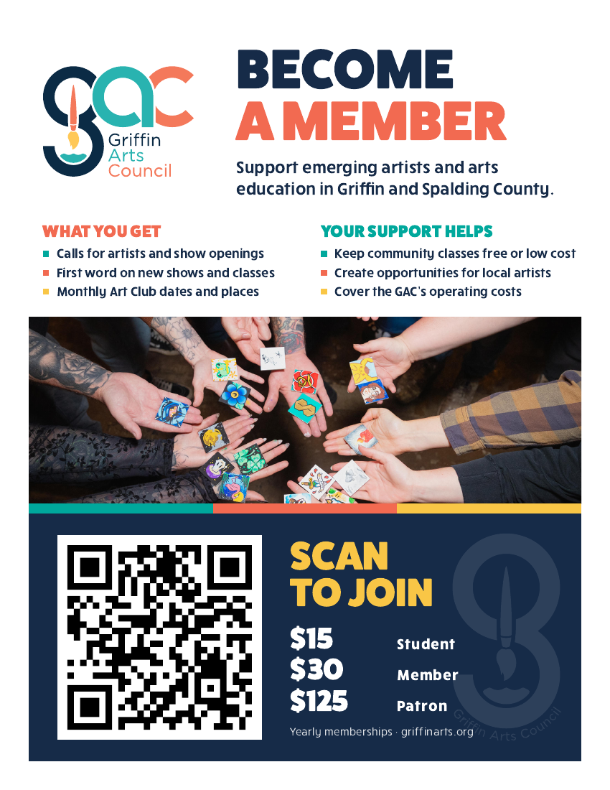
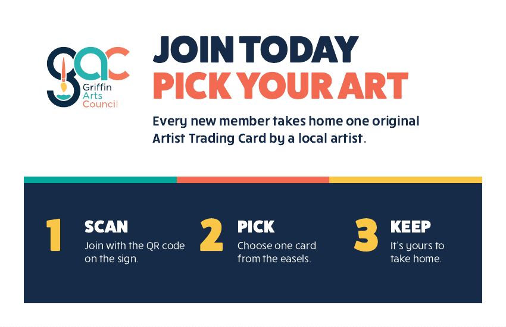

# Signs

Two signs for the membership table at GAC art shows. Both print on an ordinary color laser printer.

## Membership Table Sign

The 8.5 × 11 in sign stands in a vertical acrylic holder. Its QR code goes to the membership campaign on GiveButter, and it lists the three membership levels and what members get.

{: style="max-width: 425px; border: 1px solid #d1d5db; box-shadow: 0 1px 6px rgba(0, 0, 0, 0.08);"}

## Pick Your Art Card

This 8.5 × 5.5 in card lies flat on the table next to the Artist Trading Cards on their easels. People who join at the table pick one card to take home. The PDF prints two cards on a letter sheet, so cut on the dashed line.

{: style="max-width: 600px; border: 1px solid #d1d5db; box-shadow: 0 1px 6px rgba(0, 0, 0, 0.08);"}

## Downloads

| File | Use | Download |
|------|-----|----------|
| GAC Membership Table Sign.pdf | Ready to print, 8.5 × 11 in | [Download](/images/signs/GAC Membership Table Sign.pdf) |
| GAC Membership Table Sign.svg | Editable in Illustrator, with live text | <a href="/images/signs/GAC Membership Table Sign.svg" download="GAC Membership Table Sign.svg">Download</a> |
| GAC Pick Your Art Card - 2 per page.pdf | Ready to print, two cards per letter sheet | [Download](/images/signs/GAC Pick Your Art Card - 2 per page.pdf) |
| GAC Pick Your Art Card.svg | Editable in Illustrator, one card | <a href="/images/signs/GAC Pick Your Art Card.svg" download="GAC Pick Your Art Card.svg">Download</a> |

## Printing

- Print at **Actual size** or 100%. "Fit to page" shrinks the sign, and the QR code gets smaller.
- Nothing prints closer than 0.4 in to the edge, so printers that can't print to the edge won't clip anything.
- Scan the QR code on your first print with a phone before you print a stack.

## Editing

The SVGs use [FatFrank](https://fonts.adobe.com/fonts/fatfrank), set in a heavy weight, and [RuckSack](https://fonts.adobe.com/fonts/rucksack) from the GAC's Adobe Fonts plan. Turn those fonts on in Creative Cloud before you open a file in Illustrator. Without them, the text switches to a plain font.

For a quick change, like a new date or price for one event, edit the text in Illustrator and print from there. To change a sign for good, edit its source in the repository and rebuild. The steps are in `signs/README.md`.
