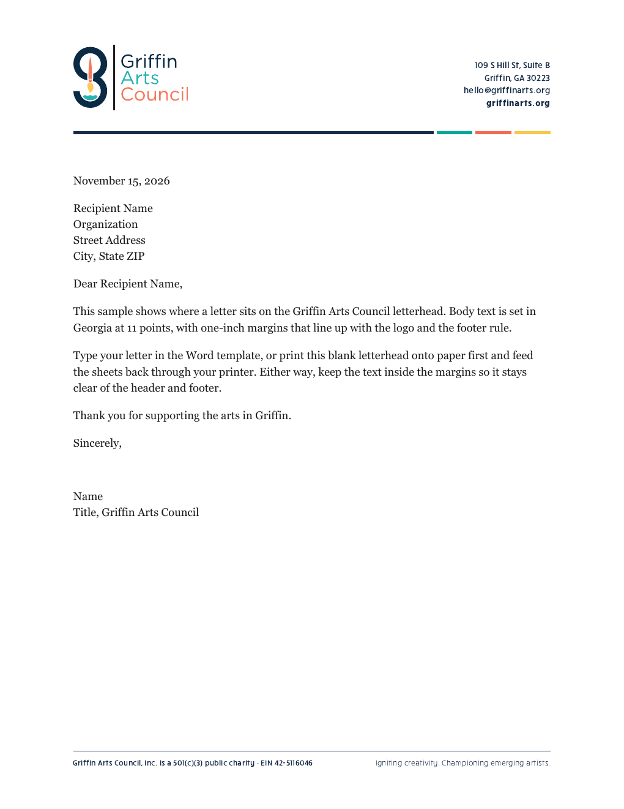

# Letterhead

Griffin Arts Council letterhead for US Letter paper. It's built to print on an ordinary office laser printer, in color or black and white.

## Downloads

| File | Use | Download |
|------|-----|----------|
| Arts Council Letterhead - Color.docx | Word template for color printers | <a href="/images/letterhead/Arts Council Letterhead - Color.docx" download="Arts Council Letterhead - Color.docx">Download</a> |
| Arts Council Letterhead - Grayscale.docx | Word template for black-and-white printers | <a href="/images/letterhead/Arts Council Letterhead - Grayscale.docx" download="Arts Council Letterhead - Grayscale.docx">Download</a> |
| Arts Council Letterhead - Color.pdf | Blank letterhead, color | [Download](/images/letterhead/Arts Council Letterhead - Color.pdf) |
| Arts Council Letterhead - Grayscale.pdf | Blank letterhead, black and white | [Download](/images/letterhead/Arts Council Letterhead - Grayscale.pdf) |

## Writing a Letter

Open the Word template, type over the placeholder text, and print. The header and footer are already in place, and the margins keep your letter clear of them. The template also opens in Google Docs (upload it to Drive, then open it with Google Docs) and in Pages.

## Printing Blank Letterhead

Use the PDF when you want a stack of letterhead sheets to print on later.

- Print at **Actual size** or 100%. "Fit to page" shrinks the page, and the logo and footer won't line up with the Word margins anymore.
- Run one test sheet before you load a stack. Printers flip paper in different ways, so mark the top of the sheet and check which side comes out printed.
- A 24 lb paper feels a bit heavier than copy paper and still feeds well through most laser printers.

## Color or Grayscale

Use the color files on color printers. On a black-and-white printer, use the grayscale files. They switch to the approved grayscale logo and solid black text, so the teal and gold don't wash out to pale gray.

Nothing on the page prints closer than half an inch to the edge, so printers that can't print to the edge won't clip anything.

## Layout

| Element | Setting |
|---------|---------|
| Paper | US Letter, 8.5 × 11 in |
| Logo | Horizontal logo, 1.56 in wide, 1 in from the left edge |
| Letter margins | 1 in left and right, 2.35 in top, 1.25 in bottom |
| Letter text | Georgia, 11 pt |
| Header and footer text | Rucksack |
| Colors | Deep Navy, Teal, Coral, and Gold from the [brand palette](#2-brand-color-palette) |

The steps for updating the letterhead are on the [Letterhead page in the repository wiki](https://github.com/jchance/GAC-assets/wiki/Letterhead).
