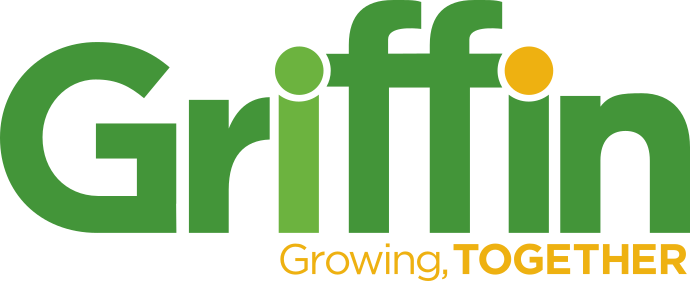
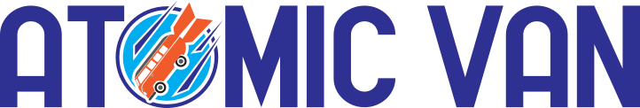
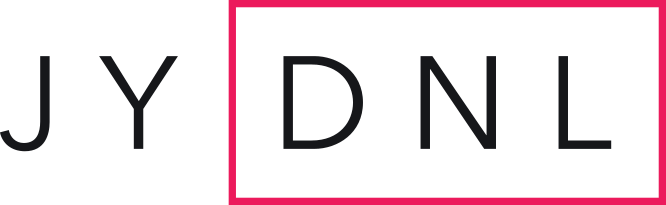
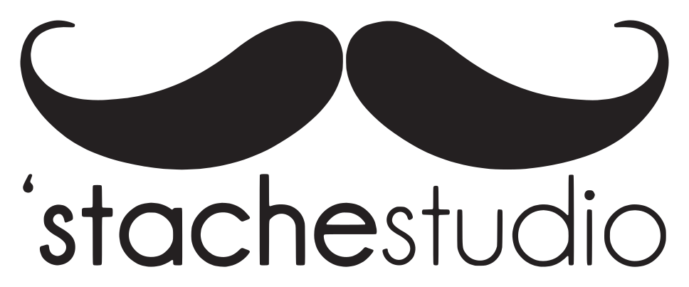

# Partner Logos

Logos for the businesses and organizations that partner with the Griffin Arts Council. Use them to thank partners on slides, signs, programs, and social posts.

These logos belong to each partner, not to the GAC. Use them as they are. Don't recolor, stretch, or crop them, and check with the partner before you use a logo for anything beyond thanking them.

The SVG stays sharp at any size and works best for print. The PNG is 1200 pixels wide with a transparent background, for Word, Canva, and slides.

| Partner | Logo | Download |
|---------|------|----------|
| [City of Griffin](https://www.cityofgriffin.com) | {: style="width: 160px;"} | <a href="/images/partner-logos/City of Griffin.svg" download="City of Griffin.svg">SVG</a> · <a href="/images/partner-logos/City of Griffin.png" download="City of Griffin.png">PNG</a> |
| [Piedmont Brewery](https://www.piedmontbrewerygriffin.com) | {: style="width: 160px;"} | <a href="/images/partner-logos/Piedmont Brewery.svg" download="Piedmont Brewery.svg">SVG</a> · <a href="/images/partner-logos/Piedmont Brewery.png" download="Piedmont Brewery.png">PNG</a> |
| [Lucky You Tattoo Emporium](https://www.luckyyoutattooemporium.com) | {: style="width: 160px;"} | <a href="/images/partner-logos/Lucky You Tattoo Emporium.svg" download="Lucky You Tattoo Emporium.svg">SVG</a> · <a href="/images/partner-logos/Lucky You Tattoo Emporium.png" download="Lucky You Tattoo Emporium.png">PNG</a> |
| [Atomic Van](https://atomicvan.com) | {: style="width: 160px;"} | <a href="/images/partner-logos/Atomic Van.svg" download="Atomic Van.svg">SVG</a> · <a href="/images/partner-logos/Atomic Van.png" download="Atomic Van.png">PNG</a> |
| [Jay Daniel Photography](https://jaydanielphotography.com) | {: style="width: 160px;"} | <a href="/images/partner-logos/Jay Daniel Photography.svg" download="Jay Daniel Photography.svg">SVG</a> · <a href="/images/partner-logos/Jay Daniel Photography.png" download="Jay Daniel Photography.png">PNG</a> |
| [Artkitect Design Lab](https://www.facebook.com/artkitectdesignlab) | {: style="width: 160px;"} | <a href="/images/partner-logos/Artkitect Design Lab.svg" download="Artkitect Design Lab.svg">SVG</a> · <a href="/images/partner-logos/Artkitect Design Lab.png" download="Artkitect Design Lab.png">PNG</a> |
| [’Stache Studio](https://stachestudio.net) | {: style="width: 160px;"} | <a href="/images/partner-logos/Stache Studio.svg" download="Stache Studio.svg">SVG</a> · <a href="/images/partner-logos/Stache Studio.png" download="Stache Studio.png">PNG</a> |

When a new partner joins, add their logo to `images/partner-logos/` and a row to this table. The GAC website keeps its own copies in `images/sponsors/`.
